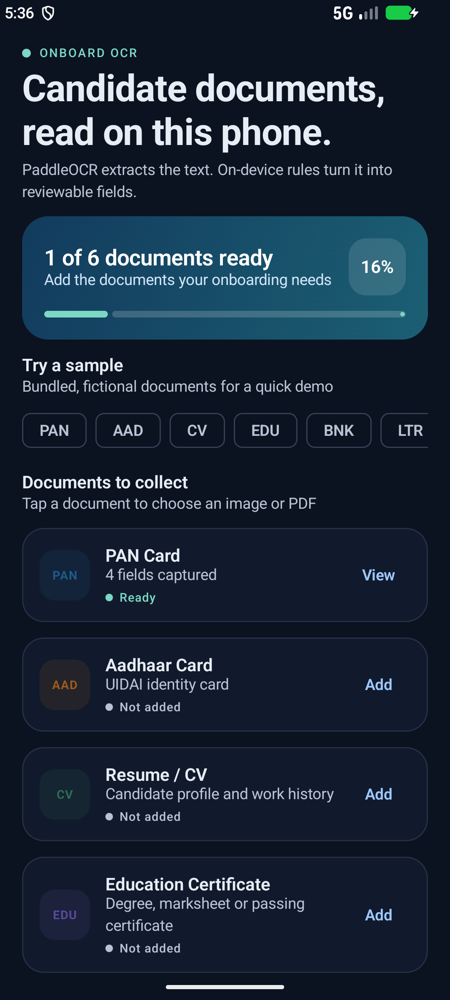
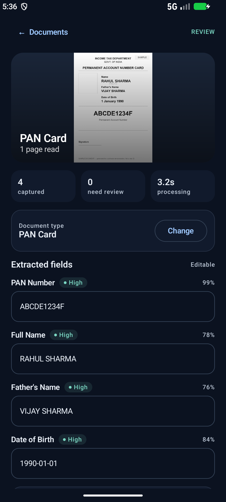
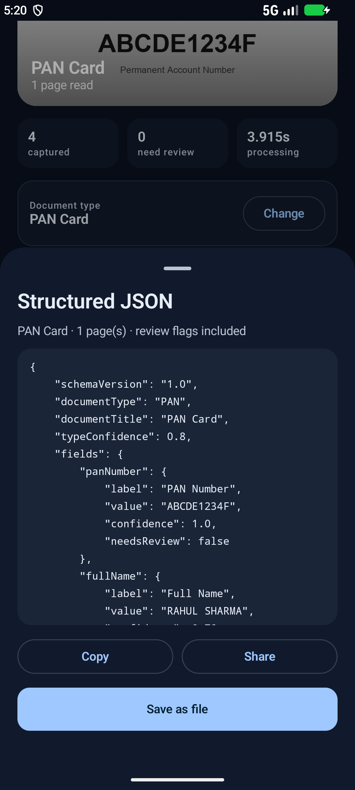

# Onboard OCR

An Android proof-of-concept that reads candidate onboarding documents **entirely on the phone** with **PaddleOCR / PP-OCRv5**, turns the text into reviewable fields, and exports structured JSON.

Package: `com.awbuilds.paddleocr`

No server, no API keys, and no `INTERNET` permission. Documents never leave the device.

| Home | Review | JSON export |
|---|---|---|
|  |  |  |

## What it does

1. Pick a document image or PDF from the device.
2. PaddleOCR's PP-OCRv5 mobile models detect, orient and recognize text on-device through Paddle-Lite.
3. A document classifier and per-type extraction rules turn the OCR lines into structured fields.
4. Review and edit the fields; uncertain values are flagged.
5. Export a pretty-printed JSON file, copy it, or share it.

The sample library includes six fictional documents for a demo. Real candidate documents are never uploaded or bundled.

## Supported documents

| Type | Extracted fields |
|---|---|
| PAN card | PAN number, full name, father's name, date of birth |
| Aadhaar card | Masked Aadhaar number, name, DOB/year, gender, address, PIN, mobile |
| Resume / CV | Name, email, phone, LinkedIn, GitHub, summary, skills, experience, education, projects, certifications |
| Education certificate | Candidate name, institution, degree, field of study, year of passing, grade/percentage |
| Bank passbook / statement | Bank name, account holder, masked account number, IFSC, branch, account type |
| Offer / experience letter | Employer, candidate, designation, joining/relieving date, employment type, CTC |

## Architecture

```text
Compose UI
  Home checklist · Processing · Review · Export
        │
  AppViewModel (StateFlow, in-memory session)
        │
  DocumentLoader          SAF picker · EXIF rotation · PDF → bitmaps
        │
  PaddleOcrEngine         JNI → Paddle-Lite 2.14rc → PP-OCRv5 mobile
        │
  TextLayout              reading order · label/value geometry
        │
  DocumentClassifier      keyword + regex confidence scoring
        │
  Extractors              PAN · Aadhaar · Resume · Education · Bank · Offer
        │
  StructuredDocument      kotlinx.serialization JSON
```

**Important:** PaddleOCR provides text and bounding boxes. The field extraction layer (classifier + rules) is the part that produces onboarding fields. Fixed-layout documents are reliable; resumes and free-form letters are best-effort and always editable.

## Native OCR stack

| Piece | Version / source |
|---|---|
| Runtime | Paddle-Lite 2.14rc CPU, arm64-v8a |
| Detection | `PP-OCRv5_mobile_det.nb` |
| Recognition | `PP-OCRv5_mobile_rec.nb` |
| Text-line orientation | `PP-LCNet_x0_25_textline_ori.nb` |
| Image processing | OpenCV 4.2.0 Android SDK (static core/imgproc) |
| JNI facade | Custom `libpaddleocr.so`, adapted from the official Paddle-Lite-Demo PP-OCRv5 Android demo |

Models are copied from `assets/ocr/` to app storage once on first use. PP-OCRv5 recognition uses 48 px input height and the 18k-character `ppocr_keys_ocrv5.txt` dictionary. The decoder was also hardened for long lines and the detection post-processor now uses heap buffers (the original demo used variable-length stack arrays that overflow on full-page documents).

## Build

### Prerequisites

- JDK 21
- Android Studio / Android SDK 35
- **Android NDK 21.4.7075529** (pinned in `app/build.gradle.kts`)
- CMake 3.22.1

Set the SDK path in `local.properties`:

```properties
sdk.dir=/Users/you/Library/Android/sdk
```

### Fetch native dependencies

The native runtimes are large, so they are not committed to source control. Download them once:

```bash
./scripts/fetch_deps.sh
```

This places Paddle-Lite in `app/PaddleLite/`, OpenCV in `app/OpenCV/`, and the PP-OCRv5 models, config and dictionary in `app/src/main/assets/ocr/`.

If those directories are already present, skip this step.

### Build and install

```bash
./gradlew :app:assembleDebug
adb install -r app/build/outputs/apk/debug/app-debug.apk
```

The APK is arm64-v8a only and is roughly 42 MB in debug.

### Demo shortcuts

The Home screen has a **Try a sample** row. You can also launch a sample directly:

```bash
adb shell am start -n com.awbuilds.paddleocr/.MainActivity --es sample pan
```

Sample keys: `pan`, `aadhaar`, `resume`, `education`, `bank`, `offer`.

## Tests

```bash
# Pure JVM extraction, date, masking and JSON tests
./gradlew :app:testDebugUnitTest

# On-device PaddleOCR inference, all six samples, PDF rendering
./gradlew :app:connectedDebugAndroidTest
```

The instrumented suite checks that each synthetic sample produces its key field, that the Aadhaar number is masked, that the resume footer does not leak into sections, and that a two-page PDF is rendered.

## JSON shape

```json
{
  "schemaVersion": "1.0",
  "documentType": "PAN",
  "documentTitle": "PAN Card",
  "typeConfidence": 0.8,
  "fields": {
    "panNumber": {
      "label": "PAN Number",
      "value": "ABCDE1234F",
      "confidence": 1.0,
      "needsReview": false
    },
    "fullName": {
      "label": "Full Name",
      "value": "RAHUL SHARMA",
      "confidence": 0.78,
      "needsReview": false
    }
  },
  "meta": {
    "engine": "PaddleOCR PP-OCRv5 mobile / Paddle-Lite",
    "pages": 1,
    "processedAt": "2026-11-23T12:00:00Z",
    "elapsedMs": 2636,
    "expectedType": "PAN",
    "detectedType": "PAN",
    "detectedTypeConfidence": 0.8,
    "warnings": []
  }
}
```

Aadhaar numbers are exported as `XXXX XXXX 1234`; account numbers as `XXXX1234`. Raw OCR text is shown in the review screen but is excluded from the exported JSON by default.

## Privacy

- No `INTERNET` permission.
- Images are processed in memory/cache and are not uploaded.
- Only a preview bitmap is retained for the current session; other PDF pages are recycled after OCR.
- Aadhaar and bank account numbers are masked before export.
- Raw OCR is opt-in for JSON export (`JsonExporter.toJson(..., includeRawText = true)`).

For a real onboarding deployment, add a retention policy, device encryption, and an explicit user consent screen before reading identity documents.

## Known limitations

- **16 KB page-size devices:** Paddle-Lite 2.14rc and OpenCV prebuilts are 4 KB aligned. Android 15+ devices with 16 KB pages show a compatibility notice and run the app in page-size compatible mode. Rebuilding Paddle-Lite and OpenCV with NDK 27 and `-Wl,-z,max-page-size=16384` is the production fix. See the Android 16 KB page-size guidance.
- **Hindi / Devanagari** is not supported by the default PP-OCRv5 mobile recognition model. English fields are the target.
- **Resumes and free-form letters** are best-effort. Tables, multi-column layouts and long experience sections may need edits; use the review screen.
- **Dates and IDs** can suffer OCR confusions (`0/O`, `1/I`) or slash misreads. The app corrects common ID confusions and normalizes dates, but flags low-confidence fields.
- **Aadhaar front and back** are separate images in this POC; a multi-page PDF is processed as one document type.
- **No persistence:** results live in the ViewModel for the session. Export is the persistence mechanism.
- PDFs are capped at 8 pages and images are downscaled before OCR for memory safety.

## Roadmap

- Hybrid mode: on-device OCR plus a backend `PP-StructureV3` / `PP-ChatOCRv4` or LLM pass for resumes and complex layouts.
- Camera capture with edge detection and perspective correction.
- Aadhaar front/back merge and an onboarding “bundle” JSON for all documents.
- Local history with Room and encrypted storage.
- 16 KB-compatible native rebuild for Play Store distribution.
- Hindi/regional recognition models.

## Attribution

This POC stands on the PaddleOCR and Paddle-Lite projects:

- [PaddleOCR](https://github.com/PaddlePaddle/PaddleOCR) — Apache-2.0
- [Paddle-Lite](https://github.com/PaddlePaddle/Paddle-Lite) — Apache-2.0
- [Paddle-Lite-Demo](https://github.com/PaddlePaddle/Paddle-Lite-Demo) (PP-OCRv5 Android demo) — Apache-2.0
- [OpenCV](https://opencv.org/) 4.2.0 — Apache-2.0
- PP-OCRv5 mobile models — PaddleOCR, Apache-2.0

The synthetic sample documents are generated by `scripts/generate_samples.py` and are not real IDs. App code is provided under Apache-2.0 for this proof of concept.
